e-Saathi Connect
Track less. Prove more.
e-Saathi Connect is an AWS-powered e-waste traceability platform designed to connect consumers and informal collection networks with authorized recycling destinations. It gives a device a recorded journey from registration and physical handover through assessment, routing, processing, verification, and closure.
Live application: https://d1xflfgysejsv2.cloudfront.net  
Source code: https://github.com/urstrulysiddhu/E-saathi-connect
> This is a hackathon MVP. The interface and workflow demonstrate a traceable collection journey; they do not replace statutory recycling records, certified data sanitisation, or independent verification of a recycler's real-world operations.
The problem
E-waste often passes through multiple hands before reaching a formal processing facility. When device identity, custody changes, evidence, and downstream outcomes are recorded inconsistently, consumers and ecosystem participants have limited visibility into what happened to a device.
e-Saathi Connect explores a practical way to make that journey easier to follow. It gives participating roles a shared device record, captures photographic evidence at key custody points, and records lifecycle transitions so that the journey can be inspected later.
What the MVP demonstrates
Device registration: capture device category, brand, model, reported condition, and photographic evidence.
Collection and handover: a collector reviews the device identity and condition before accepting custody.
Hub operations: received devices can be assessed and routed to an eligible destination.
Indicative valuation: a rule-based estimate is shown in INR. It is an estimate, not a guaranteed buyback price or a destination's agreed payment.
Destination processing: the destination workflow records processing progress and completion.
Independent verification and closure: the admin workflow can verify a completed lifecycle before closure.
Evidence and audit trail: device photographs and custody events can be reviewed against the device record.
Role-specific workspaces: consumer, collector, hub, destination, and admin views support the different stages of the journey.
Product walkthrough
The screenshots below are from the deployed application walkthrough using a VIVO S20 (128 GB) test record. They illustrate the interface and recorded journey, rather than independently proving physical recycling or data sanitisation.
1. Sign in
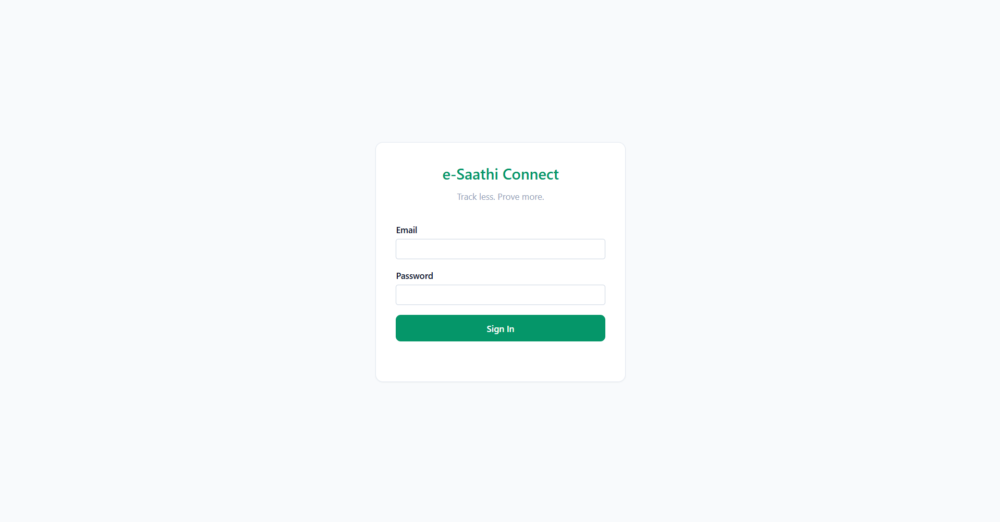
2. Register a device and capture evidence
The consumer enters device details and captures or uploads a photograph. The interface displays an indicative valuation based on the supplied category, model, and condition.
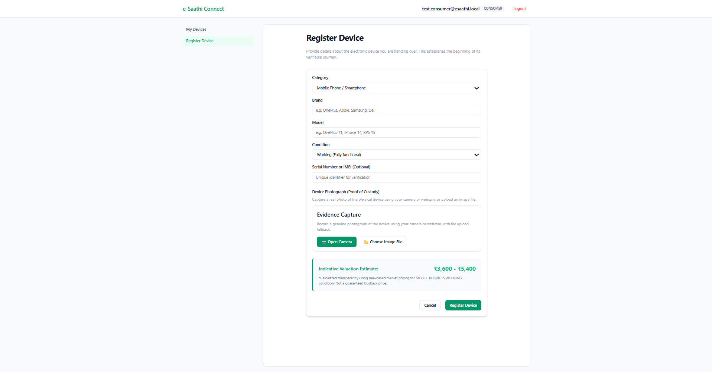
3. Consumer device record and journey
The consumer can inspect the device record, collection request, photographic evidence, lifecycle progress, and custody events.
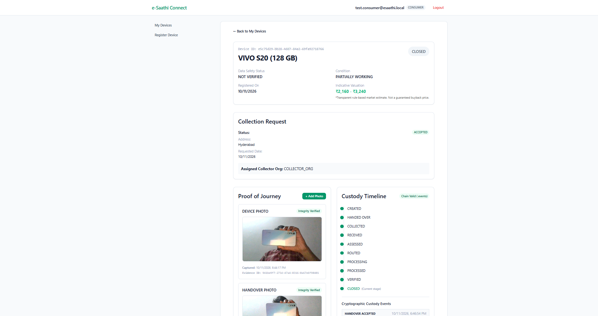

4. Collector handover
The collector reviews the device identity, declared condition, indicative valuation, and handover evidence before accepting custody.
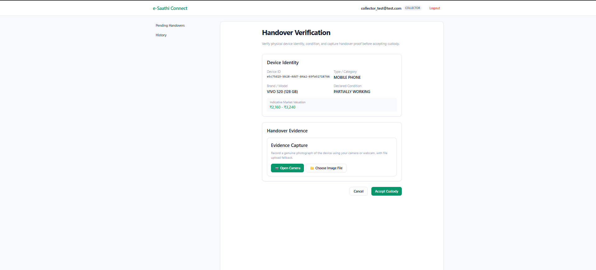
5. Hub inventory
The hub workspace provides visibility into devices held by the hub and their lifecycle states.
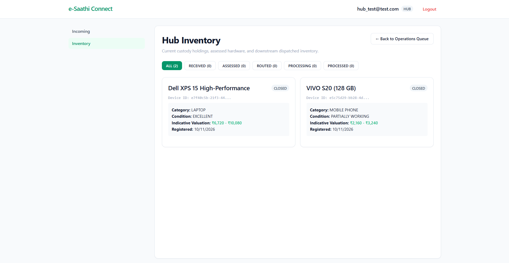
6. Destination processing records
The destination workspace provides a view of processing records and their completion status.
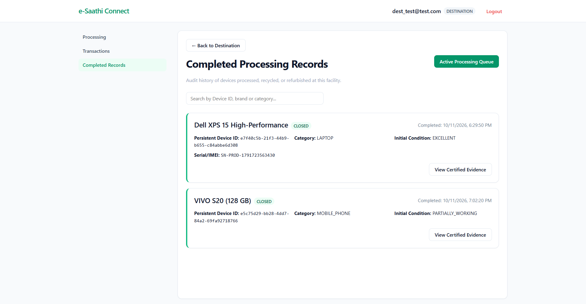
7. Admin verification queue
The admin workspace brings together devices requiring verification, verified devices, closed journeys, and the wider ecosystem inventory.
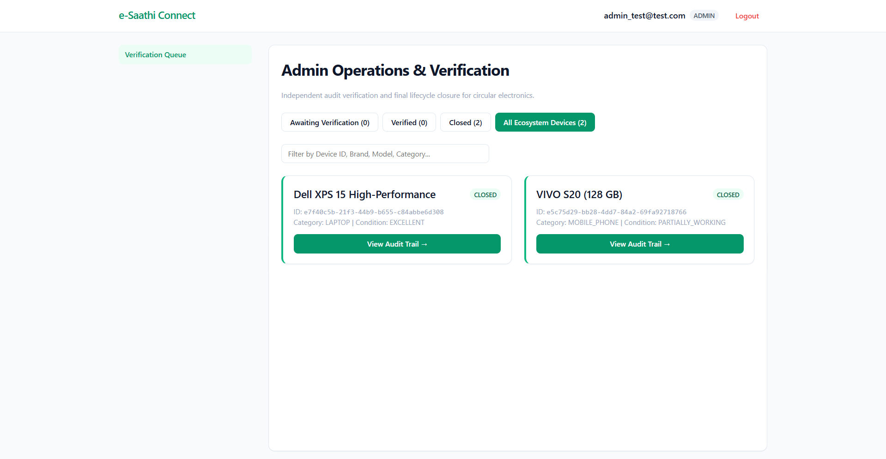
8. Device audit detail
The admin detail view brings together the device identity, lifecycle status, custody-chain validation indicator, and available photographic evidence.
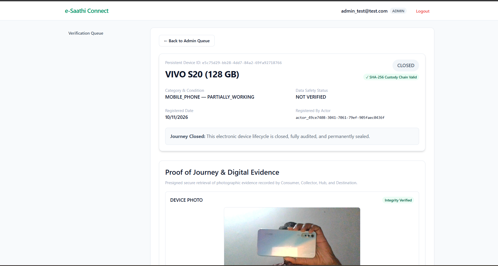
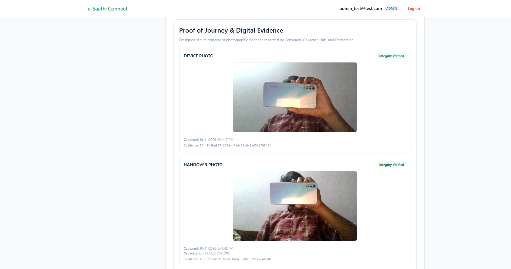
9. Custody ledger
The ledger records custody transitions, associated actors and organisations, timestamps, and hash values. The screenshot shows the VIVO S20 test record with transitions from handover through closure.
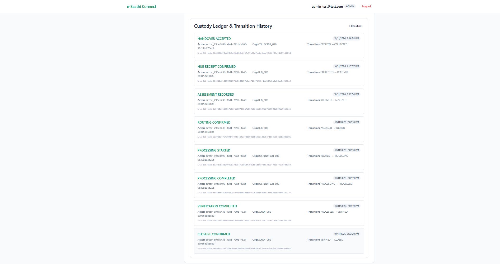
How AWS is used
AWS service	Role in the application
Amazon CloudFront	Serves the deployed web application.
Amazon S3	Stores frontend build assets and photographic evidence objects.
Amazon API Gateway	Exposes the backend API to the web client.
AWS Lambda	Runs backend request handlers and domain workflows.
Amazon DynamoDB	Persists device and workflow records.
Amazon Cognito	Supports user authentication for role-based application access.
Amazon EventBridge	Provides an event-driven integration point in the architecture.
AWS Cloud Development Kit (CDK)	Defines infrastructure as code for infrastructure synthesis and deployment.
The intended request path is browser to API Gateway, then Lambda-backed application logic, with persistence and evidence storage handled by DynamoDB and S3. EventBridge supports event-driven integration where wired into the workflow. The repository's infrastructure and source code are the definitive references for the exact deployed configuration.
Architecture at a glance
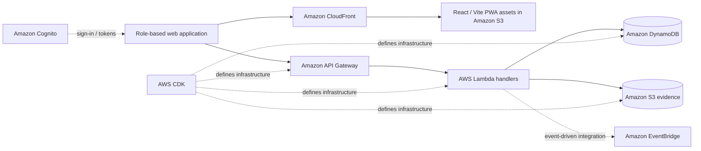
Technology stack
Frontend: React, Vite, TypeScript
Backend: TypeScript, AWS Lambda, API Gateway
Data and evidence: Amazon DynamoDB and Amazon S3
Authentication: Amazon Cognito
Event integration: Amazon EventBridge
Infrastructure as code: AWS CDK v2
Quality tooling: Jest, TypeScript, ESLint, Prettier
Repository layout
```text
.
├── apps/
│   └── web-pwa/          # React/Vite frontend and frontend tests
├── backend/
│   ├── infra/            # AWS CDK application and stack
│   ├── src/
│   │   ├── domain/       # Domain and lifecycle services
│   │   ├── functions/    # Lambda request handlers
│   │   └── infrastructure/repositories/
│   └── test/             # Backend tests
├── packages/
│   ├── core/             # Shared domain types
│   └── ui/               # Shared UI package
├── docs/                 # Architecture and product documentation
└── scripts/              # Project scripts
```
Run locally
Prerequisites
Node.js 22.x
npm
AWS credentials only if you intend to run AWS-dependent commands or deploy infrastructure
Install dependencies
```bash
npm install
```
Run validation
```bash
npm run typecheck
npm test
npm run build
```
The repository also defines `npm run validate`, which runs formatting, linting, type checks, tests, and CDK synthesis. Run it in your own environment to verify the current checkout before making changes or deploying.
Environment configuration
Create local environment files from the documented example configuration, where available. Do not commit `.env` files, AWS credentials, access tokens, private keys, generated deployment outputs, or other secrets. Frontend variables bundled into a browser application are visible to users and must never contain secrets.
Security and evidence boundaries
Authentication and role-specific views are part of the application workflow; production use requires a review of authorisation rules for every API operation.
Photographic evidence supports the recorded journey but does not, by itself, prove device ownership, data sanitisation, or certified recycling.
A valid hash chain can help reveal changes to recorded events, but it does not independently establish that the original event was truthful.
Indicative valuation is separate from a commercial offer or final settlement.
Test accounts, test records, and demonstration data are used in the screenshots. Do not use demo credentials or test data for real-world operations.
Never publish credentials, personal access tokens, `.env` files, or unredacted infrastructure secrets.
See `SECURITY.md` for the repository's security policy.
Current scope and limitations
This project is a hackathon MVP intended to demonstrate an AWS-backed workflow for e-waste collection and traceability. It is not presented as a production-certified recycling marketplace. Before real-world deployment, the system would need additional operational controls, formal recycler onboarding and authorisation checks, independently verifiable data sanitisation and recycling evidence, privacy and retention policies, security review, monitoring, and end-to-end testing with real ecosystem partners.
Built for
AWS Environmental Hacks · Bharat Builds Tour
Built with React, TypeScript, and AWS managed services.
---
If you are interested in the project, explore the code, open an issue, or share feedback on how digital custody records could improve accountability across e-waste collection networks.